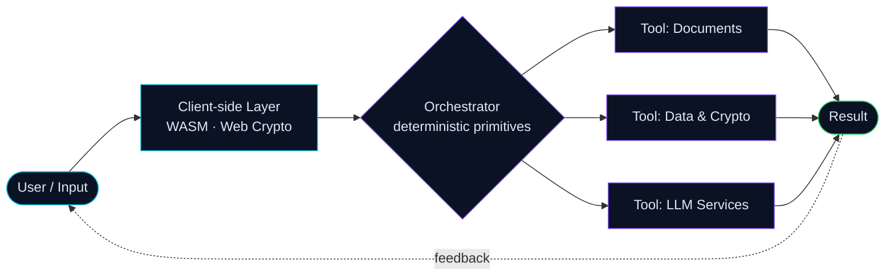

<!-- ═══════════════════════ HEADER ═══════════════════════ -->
<div align="center">

<a href="https://neziora.com">
  
</a>
<br/>


</div>
<br/>
`> whoami`
<table>
<tr>
<td width="56%" valign="top">
```yaml
operator:
  name: Uditha Manohara Prasad
  role: Software Engineer (UG)
  title: Founder & CEO, NEZIORA
  location: Colombo, Sri Lanka
mission: >
  Engineer dependable software and AI-powered
  systems that respect user privacy.
core_focus:
  - AI Engineering & agentic workflows
  - Software architecture
  - Local-first / zero-trust web apps
  - Full-stack product development
education:
  degree: BSc (Hons) Software Engineering
  awarded_by: Birmingham City University
  delivered_by: Java Institute for Advanced Technology
  also:
    - Harvard CS50x
    - Univ. of Helsinki, Java Programming I & II
```
</td>
<td width="44%" valign="top">
I design and build reliable software, intelligent pipelines and private, browser-native tools.
I start with the people, the process and the constraints, then pick technology that fits the problem.
My current direction is AI Engineering: LLM-powered features, tool-calling architectures and automation that removes repetitive work, built on a privacy-first foundation.
> *Knowledge. Vision. Connection.*
</td>
</tr>
</table>
`> ai.engineering --focus`

Principle	In practice
🧠 Agent-ready by design	Tools built as deterministic, modular primitives that AI agents can call reliably
🔒 Privacy before intelligence	Sensitive processing stays on-device wherever possible
⚙️ Automation with purpose	AI used to cut repetitive effort, e.g. AI quiz generation in MindSprint
🏗️ Production discipline	Auth, Row Level Security, signed control planes and documented delivery
`> ./neziora --status`
<div align="center">
<a href="https://neziora.com"></a>
</div>
NEZIORA (formerly Neziora Solutions) is a future-driven, AI-engineering technology brand based in Colombo. It builds dependable software architectures, automated intelligence pipelines and private client-native computing. Its vision is technology the world can depend on.
The Five Pillars: `Knowledge` · `Vision` · `Connection` · `The Process` · `The Star`
🧪 Flagship: Neziora Tools Hub: 31 free, private, client-side tools
```text
┌─────────────────────────┬───────────────────────────────────────────────┐
│ PDF & Document Suite    │ merge · split · rotate · organize · watermark │
│ Branded Visual Studio   │ logo QR · palette studio · EXIF sanitizer     │
│ Developer & Data Studio │ JSON · live Markdown · checksums · passwords  │
│ Regional & Everyday     │ NIC decoder · Singlish Unicode · invoices     │
└─────────────────────────┴───────────────────────────────────────────────┘
```
🗂️ Case Files
ID	System	Stack	Highlights
`NZ-01`	Neziora Tools Platform	WebAssembly · Web Crypto · Supabase Auth	100% client-side processing
`NZ-02`	Autonomous Edge Control Deck	Edge Storage · HMAC-SHA256 · Netlify API	Zero-DB admin matrix with instant site lockdown
`NZ-03`	Ceylon GridPulse & Tariff Engine	WASM · PUCSL slabs	2026 CEB/LECO tariffs, solar net-metering ROI, offline
`NZ-04`	Ceylon PayGuard & LankaQR Suite	EMVCo · PDF-Lib · Sinhala fonts	LankaQR generator, cheque writer, in-memory invoices
`> ls ./products`
Product	What it does	Stack
Neziora LeadFlow	Lead pipeline, follow-ups, PDF quotations and job tracking in a private workspace	Supabase · Row Level Security
SecureShield (in development)	Unified privacy, verification and digital-safety services under one account	Firebase Auth
MindSprint	Focus and study platform with AI quiz generation and Google sync	Vercel · Google Sign-In
Crestline Graphics	Motion-led agency web system with a client portal	Full-stack web
UMP Singlish	Type Singlish, get Sinhala Unicode ⭐	JavaScript · Electron
JustReceipt Pro	Simple, secure, smart receipt generator	JavaScript
`> cat ./research`
> 📄 Published work with persistent identifiers.
Type	Title	Identifier
📘 Paper	`REPLACE_WITH_TITLE_1`	
📘 Paper	`REPLACE_WITH_TITLE_2`	
📑 White Paper	`REPLACE_WITH_TITLE`	
`> cat ./stack`
<div align="center">
Languages & Core<br/>

Frameworks & Runtime<br/>

Cloud, Backend & Deployment<br/>

Environment<br/>

</div>
`> ./telemetry`
<div align="center">


</div>
`> ./connect`
👤 Uditha Manohara Prasad
<p>
<a href="https://www.linkedin.com/in/uditha-manohara/"></a>
<a href="https://www.facebook.com/udithamprasad/"></a>
<a href="https://www.instagram.com/uditha.manohara/"></a>
<a href="https://x.com/uditha_manohara"></a>
<a href="https://www.tiktok.com/@udithamprasad"></a>
<a href="https://wa.me/94761823815"></a>
<a href="mailto:udithamprasad@gmail.com"></a>
<a href="https://udithamanohara.dev"></a>
</p>
🚀 NEZIORA
<p>
<a href="https://neziora.com"></a>
<a href="https://www.linkedin.com/company/neziora"></a>
<a href="https://www.facebook.com/neziora/"></a>
<a href="https://www.instagram.com/nezioraofficial/"></a>
<a href="https://x.com/Neziora"></a>
<a href="https://www.tiktok.com/@neziora"></a>
<a href="https://wa.me/94726545635"></a>
</p>
<div align="center">
<sub>Freelance: business websites · web applications · website improvements · AI-assisted automation</sub>
</div>
<br/>
<div align="center">

</div>
