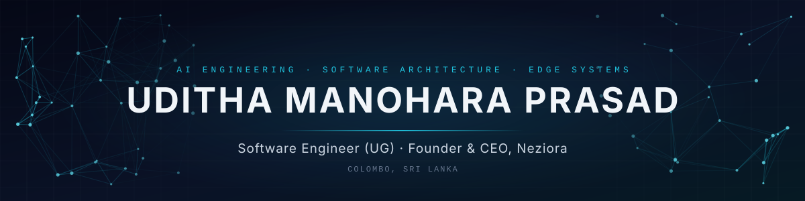

<div align="center">



<p>
<a href="https://udithamanohara.dev">Portfolio</a> &nbsp;·&nbsp;
<a href="https://neziora.com">Neziora</a> &nbsp;·&nbsp;
<a href="https://doi.org/10.5281/zenodo.23995414">EDIP Paper</a> &nbsp;·&nbsp;
<a href="https://orcid.org/0009-0003-1178-5309">ORCID</a> &nbsp;·&nbsp;
<a href="https://www.linkedin.com/in/uditha-manohara/">LinkedIn</a> &nbsp;·&nbsp;
<a href="mailto:udithamprasad@gmail.com">Email</a>
</p>

<p>
I build reliable software and AI systems that run where the data lives.<br/>
My focus is making <b>small, locally deployed language models dependable enough for production data workflows</b>,<br/>
using deterministic constraints rather than larger models or cloud APIs.
</p>

<table>
<tr>
<td align="center" width="25%"><h3>1B–3B</h3><sub>PARAMETER MODELS<br/>SUPERVISED ON-DEVICE</sub></td>
<td align="center" width="25%"><h3>100%</h3><sub>OFFLINE · CPU-ONLY<br/>NO CLOUD CALLS</sub></td>
<td align="center" width="25%"><h3>5</h3><sub>ADVERSARIAL SCENARIOS<br/>IN THE EDIP BENCHMARK</sub></td>
<td align="center" width="25%"><h3>31</h3><sub>CLIENT-SIDE TOOLS<br/>SHIPPED ON NEZIORA</sub></td>
</tr>
</table>


<h2>Research</h2>

<h3>EDIP · Edge Deterministic Ingestion Protocol</h3>
<p><i>Closed-Loop Relational Constraint Reflection for Autonomous Document Ingestion on Quantized Edge Models</i></p>

<a href="https://doi.org/10.5281/zenodo.23995414"></a>
<a href="https://doi.org/10.5281/zenodo.23995358"></a>


<p>
Organizations under data-residency rules cannot send documents to commercial cloud AI, and the small models that run on a standard workstation often emit invalid foreign keys, malformed numerics and missing fields.<br/>
EDIP uses the relational database as the supervisor: a rejected write is caught as a native <code>IntegrityError</code>, rolled back, and the exact error plus the valid candidate keys are fed back to the model in a bounded retry loop. Unresolvable records go to a dead-letter queue for human review.
</p>

<table>
<tr>
<th align="center">Design</th>
<th align="center">Evaluation</th>
<th align="center">Stated limits</th>
</tr>
<tr>
<td valign="top" align="left">
Offline, CPU-only inference<br/>
SQLite PK / FK / CHECK / UNIQUE as the gate<br/>
WAL concurrency<br/>
Dynamic schema introspection<br/>
Atomic multi-table transactions<br/>
Tri-folder routing with audit table
</td>
<td valign="top" align="left">
Intel Core i3-10100, 12 GB RAM<br/>
Llama-3.2-1B (4-bit) via Ollama<br/>
Deprecated keys · prose amounts<br/>
Prompt injection · duplicates<br/>
Unregistered entities<br/>
Invalid records contained in every case
</td>
<td valign="top" align="left">
Structural validity, not factual truth<br/>
~8–10 s per document on retry (CPU)<br/>
Reference schema two levels deep<br/>
Evaluated on a synthetic suite
</td>
</tr>
</table>

<p>
<a href="https://doi.org/10.5281/zenodo.23995414"><b>White paper</b></a> &nbsp;·&nbsp;
<a href="https://doi.org/10.5281/zenodo.23995358"><b>Engine (software)</b></a> &nbsp;·&nbsp;
<a href="https://pypi.org/project/edip/"><b>PyPI</b></a> &nbsp;·&nbsp;
<a href="https://github.com/uditha-manohara/edip"><b>Source</b></a>
</p>

<details>
<summary>Cite this work</summary>
<br/>

```bibtex
@misc{prasad2026edip,
  author    = {Prasad, Uditha Manohara},
  title     = {Edge Deterministic Ingestion Protocol (EDIP): Closed-Loop Relational
               Constraint Reflection for Autonomous Document Ingestion on Quantized Edge Models},
  year      = {2026},
  publisher = {Zenodo},
  doi       = {10.5281/zenodo.23995414}
}
```

</details>


<h2>Engineering Focus</h2>

<table>
<tr>
<td width="25%" valign="top" align="center"><b>Applied AI</b><br/><sub>Constraint-supervised small-model pipelines · error-feedback loops · LLM-assisted features · agent-callable tool design</sub></td>
<td width="25%" valign="top" align="center"><b>Local-first &amp; Privacy</b><br/><sub>WebAssembly and Web Crypto processing · zero-retention architectures · offline computation</sub></td>
<td width="25%" valign="top" align="center"><b>Architecture</b><br/><sub>Row Level Security · zero-database edge control planes · HMAC-signed administration · idempotent workflows</sub></td>
<td width="25%" valign="top" align="center"><b>Full-stack Delivery</b><br/><sub>Dashboards and portals · authentication · PDF and document engines · deployment</sub></td>
</tr>
</table>

<p>
<sub><b>PYTHON · JAVASCRIPT · TYPESCRIPT · JAVA · PHP · SQL (SQLITE, MYSQL) · REACT · NODE.JS · ELECTRON · TAILWIND · SUPABASE · FIREBASE · OLLAMA · LINUX</b></sub>
</p>


<h2>Neziora</h2>

<p>
<a href="https://neziora.com"><b>Neziora</b></a> is an AI-engineering technology brand building dependable software, automated intelligence pipelines and private client-native computing.
</p>

<table>
<tr>
<td align="center" valign="top" width="25%"><a href="https://neziora.com/tools"><b>Tools Hub</b></a><br/><sub>31 browser-based utilities for documents, data, security and regional use</sub></td>
<td align="center" valign="top" width="25%"><a href="https://neziora.com/tools/ceb-bill-calculator"><b>Ceylon GridPulse</b></a><br/><sub>2026 CEB/LECO tariff and solar net-metering engine, fully offline</sub></td>
<td align="center" valign="top" width="25%"><a href="https://neziora.com/tools/cheque-writer"><b>PayGuard &amp; LankaQR</b></a><br/><sub>CBSL EMVCo-compliant QR, cheque writer, in-memory invoicing</sub></td>
<td align="center" valign="top" width="25%"><a href="https://neziora.com/forum"><b>Research Forum</b></a><br/><sub>Neziora's research and engineering discussion space</sub></td>
</tr>
</table>

<h3>Selected Products</h3>

<table>
<tr>
<td align="center" valign="top" width="33%"><a href="https://neziora-leadflow.netlify.app/"><b>Neziora LeadFlow</b></a><br/><sub>Leads, quotations and jobs in private workspaces with Supabase RLS</sub></td>
<td align="center" valign="top" width="33%"><a href="https://mindsprintlk.vercel.app/"><b>MindSprint</b></a><br/><sub>Study-focus platform with AI quiz generation</sub></td>
<td align="center" valign="top" width="33%"><a href="https://shield-platform.web.app/"><b>SecureShield</b></a><br/><sub>Privacy and digital-safety platform (in development)</sub></td>
</tr>
<tr>
<td align="center" valign="top"><a href="https://crestlinegraphics.com/"><b>Crestline Graphics</b></a><br/><sub>Agency web system with client portal</sub></td>
<td align="center" valign="top"><a href="https://github.com/uditha-manohara/ump-singlish"><b>UMP Singlish</b></a><br/><sub>Singlish to Sinhala Unicode converter</sub></td>
<td align="center" valign="top"><a href="https://github.com/uditha-manohara/invoice-generator"><b>JustReceipt Pro</b></a><br/><sub>Secure receipt generator</sub></td>
</tr>
</table>


<h2>Education</h2>

<p>
<b>BSc (Hons) Software Engineering</b><br/>
<sub>Birmingham City University · delivered by the Java Institute for Advanced Technology</sub><br/><br/>
<sub>Harvard CS50x &nbsp;·&nbsp; University of Helsinki, Java Programming I &amp; II</sub>
</p>


<h2>Contact</h2>

<p><sub>For software engineering, AI systems and research collaboration</sub></p>

<table>
<tr><th></th><th align="center">Uditha Manohara Prasad</th><th align="center">Neziora</th></tr>
<tr><td><b>Email</b></td><td align="center"><a href="mailto:udithamprasad@gmail.com">udithamprasad@gmail.com</a></td><td align="center"><a href="https://neziora.com">neziora.com</a></td></tr>
<tr><td><b>WhatsApp</b></td><td align="center"><a href="https://wa.me/94761823815">+94 76 182 3815</a></td><td align="center"><a href="https://wa.me/94726545635">+94 72 654 5635</a></td></tr>
<tr><td><b>LinkedIn</b></td><td align="center"><a href="https://www.linkedin.com/in/uditha-manohara/">uditha-manohara</a></td><td align="center"><a href="https://www.linkedin.com/company/neziora">company/neziora</a></td></tr>
<tr><td><b>X</b></td><td align="center"><a href="https://x.com/uditha_manohara">@uditha_manohara</a></td><td align="center"><a href="https://x.com/Neziora">@Neziora</a></td></tr>
<tr><td><b>Instagram</b></td><td align="center"><a href="https://www.instagram.com/uditha.manohara/">@uditha.manohara</a></td><td align="center"><a href="https://www.instagram.com/nezioraofficial/">@nezioraofficial</a></td></tr>
<tr><td><b>Facebook</b></td><td align="center"><a href="https://www.facebook.com/udithamprasad/">udithamprasad</a></td><td align="center"><a href="https://www.facebook.com/neziora/">neziora</a></td></tr>
<tr><td><b>TikTok</b></td><td align="center"><a href="https://www.tiktok.com/@udithamprasad">@udithamprasad</a></td><td align="center"><a href="https://www.tiktok.com/@neziora">@neziora</a></td></tr>
</table>

<br/>


</div>
